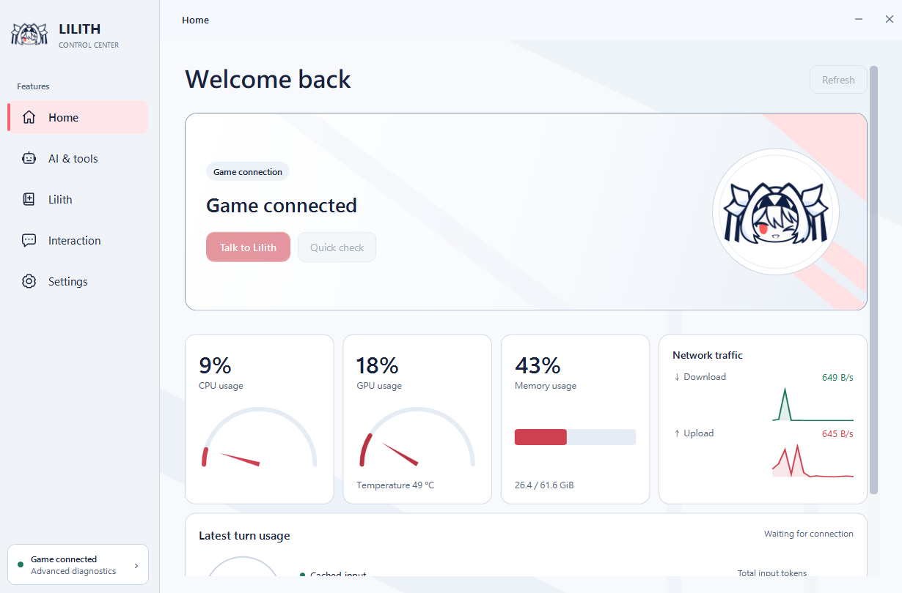
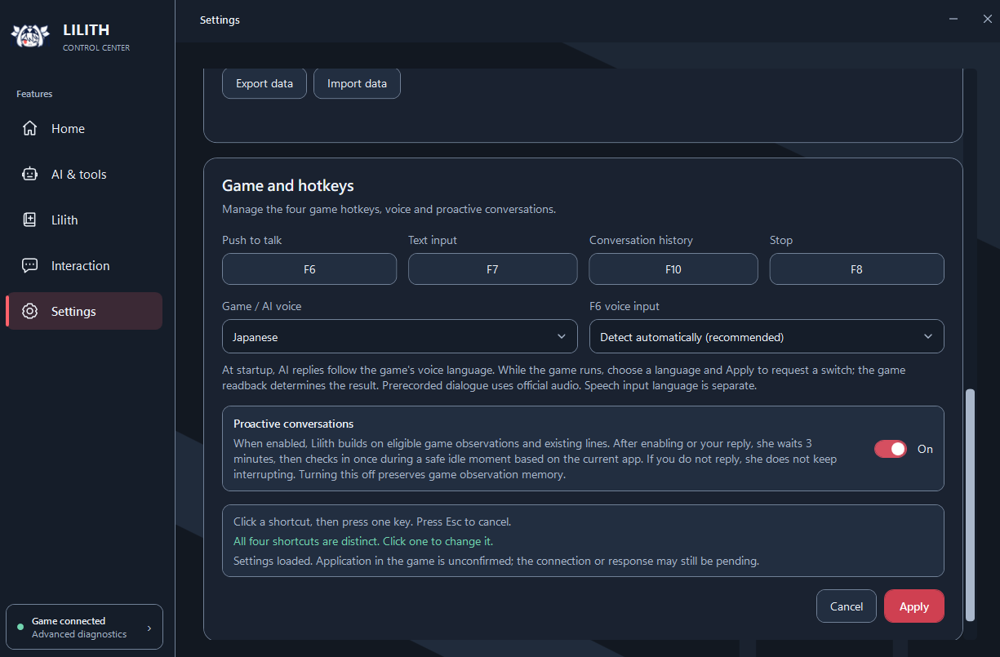

# Lilith AI MOD · 1.0.0 Beta.4

[繁體中文](README_繁體中文.md) · [简体中文](README_简体中文.md) · [English](README_EN.md) · [日本語](README_日本語.md)

讓莉莉絲陪你聊天、記住相處中的小事，也能一起抽鬼牌、下西洋棋。Beta.4 已改用獨立控制中心與新的記憶、模型和工具架構；舊版 LOCAL 啟動方式不再適用。

這是非官方、非商業用途的社群 MOD，需要 Windows 64 位元與 Steam 莉莉絲本體。

## 下載與安裝

- [Google 雲端：Beta.4](https://drive.google.com/drive/folders/1q8GcsuKSjPZCbKw8HYrMYR1dgThBhfUe?usp=sharing)
- [百度網盤：Beta.4](https://pan.baidu.com/s/1xAt9y_MZ1DJMohHZ90bEQw?pwd=6666)，提取碼 **6666**
- [完整安裝／更新教學](docs/INSTALLATION.md) · [Discord 社群](https://discord.gg/b3eJJhEfAC)

主包約 **4.99 GB**；可選 AI 語音依賴包約 **3.70 GB**，須另行下載。主包已有小遊戲圖片、音效與固定中日錄音；即時 AI 合成語音另需相容依賴。

1. 關閉遊戲與控制中心，解壓主包。
2. 將 `Setup.exe` 與 `Main.zip` 放在同一資料夾；不用解壓 Main.zip。
3. 執行安裝器，選擇含 `Lilith.exe` 的遊戲位置，依需要選裝語音。
4. 從 **Lilith AI MOD 桌面捷徑**開啟控制中心，設定模型，再從 Steam 開啟遊戲。

**舊架構／先前封閉測試版的記憶與 Beta.4 不相容。** 首次遷移須依[安裝教學](docs/INSTALLATION.md)清除莉莉絲專用的舊程式與舊資料，再全新安裝；不要保留、搬入或匯入舊聊天／記憶／設定。不要自行刪除整個系統 LOCAL、AppData 或 BepInEx。

只有日後明確聲明相容的新版架構更新，才可沿用資料。「完全離線」指安裝依賴來源；雲端模型仍須網路與自己的帳號／API 設定。不要再使用舊啟動批次檔。

## 獨立控制中心

聊天、模型、記憶、互動與工具集中管理；支援獨立聊天室、圖片附件與生成圖片預覽。首頁顯示遊戲連線、全機資源與最近一輪模型用量；提供深淺主題、跟隨系統、系統匣與可選登入啟動。



- **記憶管理：** 喜好、習慣、重要約定、暫時安排與共同經歷分開整理。可修正、釘選、隱藏或刪除；推測資料留待確認，自動記憶可關閉。
- **資料保存：** 匯出／匯入新版相容的聊天與記憶；不支援舊架構記憶。匯入會覆蓋目前資料，請先自行備份；存檔不包含 API 金鑰。
- **模型選擇：** Gemini、DeepSeek、OpenAI、Anthropic、OpenRouter 等服務，以及自訂相容雲端、Ollama、LM Studio 等本機服務。各模型能力與服務費用不同，本機服務需自行準備。
- **六檔資訊策略：** 從節能到豐富上下文，搭配工具按需載入；不刪原始聊天，也不是固定費用保證。
- **工具協助：** 依已啟用工具與授權，搜尋網頁、操作瀏覽器／Windows、處理檔案及使用媒體服務；也可設定 Telegram 聊天。

## 陪伴、畫面與語音

本地畫面理解先在電腦分析畫面與文字，再提供聊天線索。功能可獨立開關，並非持續監看。**若聊天模型在雲端，整理後的文字仍會送往該服務；其他圖片工具也可能使用雲端辨識。**

主動對話能延伸原有台詞，或在合適空檔關心目前情境；沒有回覆時不會一直催促。另有自動留信、每日上限、手動請她寫信與備忘錄功能。中日聲線及日文情緒表現已更新，朗讀與輸入語言可以分開設定。



| 語言範圍 | 支援內容 |
| --- | --- |
| 控制中心 | 繁中、簡中、日文、英文、俄文 |
| 小遊戲字幕／選單 | 繁中、簡中、日、英、韓、俄、拉美西語、巴西葡語、印尼、泰、土耳其、越南，共12語 |
| 配音 | 中文、日文；小遊戲182句對應台詞，共364段固定錄音 |

## 一起玩小遊戲

**抽鬼牌：** 從點心時間進入，可拖曳整理手牌，莉莉絲也會整理自己的牌。抽牌、配對亮牌、自然散落的拋牌動作與音效都已加入。她可以調皮地虛張聲勢，問鬼牌在哪，也未必得到老實答案。


**西洋棋：** 粉白偽3D棋盤，支援點選與拖曳、合法位置灰點、選取／將軍光暈及升變。休閒不計時，挑戰可調時間；輪流先手，難度依勝負逐步調整，莉莉絲會稍作思考再落子。雙擊她可叫出對局選項。走棋由本機 Stockfish 處理，難度不是正式認證 Elo。


**邊玩邊聊：** 已完成的抽牌、配對、走棋與吃子先在本機累積；你用 F6／F7 開口，或她主動說話時，再附上這段經過和最新局面。她能跟上自己的手牌與棋局變化；不會每走一步就呼叫聊天模型，也不是永久完整棋譜。

## 其他更新與操作

- 預設 **F6** 語音、**F7** 文字、**F10** 對話紀錄、**F8** 停止，可在設定修改。
- 原有播放器加入 FLAC；莉莉絲在前景且非打字時，**Ctrl+←／→** 切歌，**Ctrl+Space** 暫停／繼續。
- 整合 LilithCursorGuard，改善莉莉絲在背景時干擾其他遊戲游標限制的問題。

## 現在的架構

```text
控制中心：聊天、設定、記憶管理
              ↓
本機服務 + Hermes ↔ 選用的雲端／本機模型
              ↕
莉莉絲遊戲：語音、互動、小遊戲
```

模型負責對話與工具協助；遊戲規則、實際互動與語音播放由本機程式處理。功能表列出選項不代表所有服務都已連線；效果與資源需求依模型、設定和硬體而異。

## 原始碼與致謝

[建置說明](BUILDING.md)。發行包與原始碼用途不同；安裝玩家請使用上方完整發行包。

感謝 [Hermes Agent](https://github.com/NousResearch/hermes-agent)、[SmallYuanSY／LilithCursorGuard](https://github.com/SmallYuanSY/LilithCursorGuard)（MIT）、[Kenney Casino Audio](https://kenney.nl/assets/casino-audio)（CC0）、[Stockfish](https://github.com/official-stockfish/Stockfish)（GPL-3.0）、[Gera.Chess](https://github.com/Geras1mleo/Chess)、[GPT-SoVITS](https://github.com/RVC-Boss/GPT-SoVITS) 及其他上游專案。整合不代表上游官方背書；各元件、模型與素材依各自授權使用，完整通知隨發行包提供。

回報問題時，請附版本、重現步驟與控制中心診斷；不要公開 API 金鑰、私人聊天或記憶存檔。[加入 Discord](https://discord.gg/b3eJJhEfAC)。
