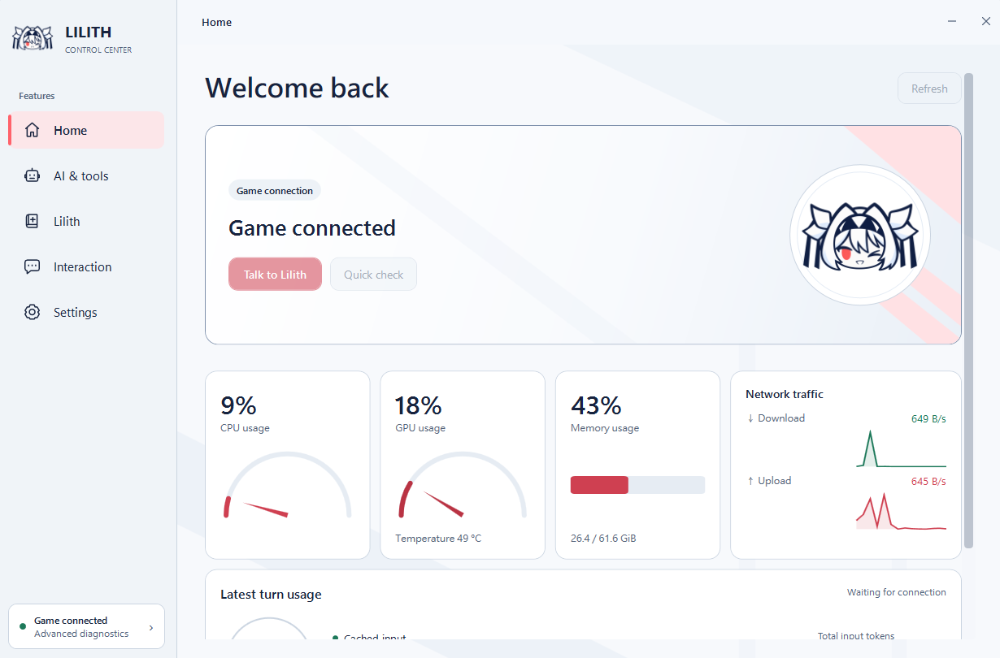
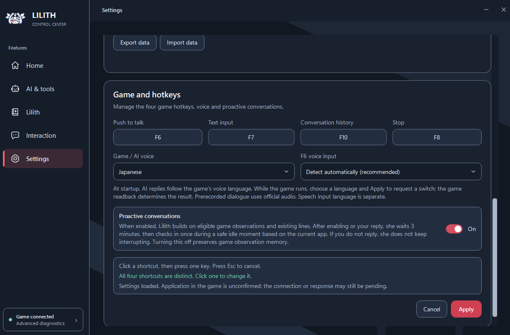
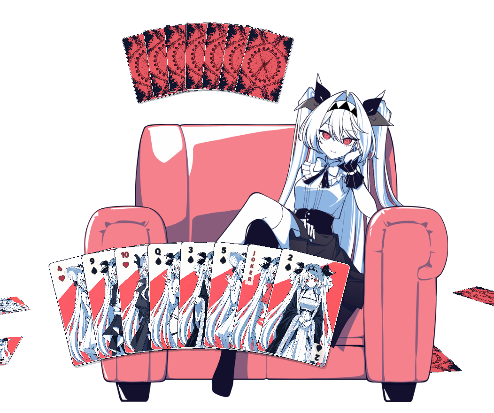
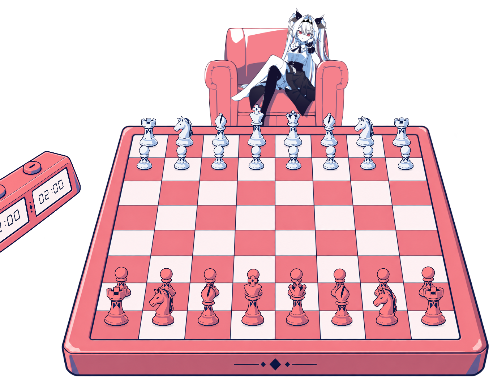

# Lilith AI MOD · 1.0.0 Beta.4

[繁體中文](README_繁體中文.md) · [简体中文](README_简体中文.md) · [English](README_EN.md) · [日本語](README_日本語.md)

Chat with Lilith, build shared memories, and play Old Maid or chess together. Beta.4 introduces a standalone Control Center and a revised memory, model and tool architecture. The old LOCAL launcher workflow is no longer used.

This unofficial, noncommercial community-made MOD requires 64-bit Windows and the original Lilith game on Steam.

## Download and install

- [Google Drive: Beta.4](https://drive.google.com/drive/folders/1q8GcsuKSjPZCbKw8HYrMYR1dgThBhfUe?usp=sharing)
- [Baidu Netdisk: Beta.4](https://pan.baidu.com/s/1xAt9y_MZ1DJMohHZ90bEQw?pwd=6666) — code **6666**
- [Full installation and update guide](docs/INSTALLATION_EN.md) · [Discord community](https://discord.gg/b3eJJhEfAC)

The main download is approximately **4.99 GB**. The optional **3.70 GB AI voice dependency archive is a separate download**. Minigame art, sound effects and fixed Chinese/Japanese recordings are included in the main package; live AI speech synthesis needs compatible voice dependencies.

1. Exit the game and Control Center, then extract the main download.
2. Keep `Setup.exe` beside `Main.zip`; do not extract Main.zip.
3. Run Setup, select the game folder containing `Lilith.exe`, and choose voice support if wanted.
4. Open Control Center using the **Lilith AI MOD desktop shortcut**, configure a model, then start Lilith through Steam.

**Memories from the old architecture and earlier closed-test builds are incompatible with Beta.4.** For your first migration, follow the [installation guide](docs/INSTALLATION_EN.md) to remove Lilith's specific old program files and data, then install fresh. Do not retain, copy back or import old chats, memories or settings. Do not delete the entire system LOCAL, AppData or BepInEx folder.

Data reuse applies only to future new-architecture updates explicitly marked compatible. “Offline only” concerns installation dependencies: cloud models still need internet access and your own service credentials. Do not use old launcher batch files.

## Standalone Control Center

Manage chat, models, memories, interaction and tools in one application. It includes separate chat sessions, image attachments and generated-image previews. The home page shows game connection, whole-PC resources and recent model usage. Light, dark and system themes, a notification-area icon and optional login startup are available.



- **Memory management:** lasting preferences, habits, agreements, temporary plans and shared experiences. Review inferences before accepting them; edit, pin, hide or delete entries, or turn automatic memory formation off.
- **Portable data:** export and import compatible new-architecture chat and memory, not old-architecture memories. Import overwrites current data, so export a backup first. API keys are excluded.
- **Model choice:** Gemini, DeepSeek, OpenAI, Anthropic, OpenRouter, custom compatible cloud services, Ollama, LM Studio and other local-compatible services. Capabilities and charges vary; local model services must be prepared separately.
- **Six context strategies:** choose between saving-oriented and richer recent context, with on-demand tool loading. These do not delete original chats or guarantee a fixed bill.
- **Tools:** use enabled, authorized tools for web search, browser and Windows interaction, files and media services. Telegram chat can also be configured. External services may require their own accounts and setup.

## Companionship, screen context and voice

Local screen understanding analyzes the current screen and text on your computer, then supplies useful context for conversation. It has a separate switch and is not continuous monitoring. **If you use a cloud chat model, the extracted text is still sent to that service. Other image tools may also use cloud vision.**

Proactive conversation can follow eligible original dialogue or comment during a suitable idle moment. Lilith does not repeatedly prompt you when you do not respond. Automatic letters have a daily limit; you can also enable requests for a handwritten-style letter or use notes. Chinese/Japanese voices and Japanese expressive delivery have been updated, with speech and input languages configured separately.



| Language scope | Available languages |
| --- | --- |
| Control Center | Traditional Chinese, Simplified Chinese, Japanese, English, Russian |
| Minigame subtitles and menus | Traditional/Simplified Chinese, Japanese, English, Korean, Russian, Latin American Spanish, Brazilian Portuguese, Indonesian, Thai, Turkish, Vietnamese — 12 languages |
| Voice | Chinese and Japanese; 182 paired minigame lines, 364 fixed recordings |

## Play together

**Old Maid:** start from snack time, drag to reorder your hand, and watch Lilith rearrange hers. Drawing, revealing pairs and tossing cards have animation and sound. She may bluff in fixed lines or conversation—even when you ask where the Joker is.



**Chess:** a pink-and-white pseudo-3D board with click or drag movement, legal-move dots, selection/check highlights and promotion. Casual mode is untimed; Challenge has adjustable clocks. First move alternates, difficulty adjusts with results, and Lilith takes a short thinking pause. Double-click her for match options. Local Stockfish handles moves; difficulty is not a certified Elo rating.



**Chat during a match:** completed draws, pairs, moves and captures accumulate locally. When you speak through F6/F7, or Lilith initiates a conversation, the recent events and current position accompany that turn. She can follow her hand and the board instead of acting like a spectator. Every move does not trigger a chat-model request, and retained context is not a permanent full-match record.

## More improvements and controls

- Default shortcuts: **F6** voice input, **F7** text input, **F10** conversation history, **F8** stop. They are configurable.
- The original music player supports FLAC. With Lilith in the foreground and no text input active, **Ctrl+Left/Right** changes track and **Ctrl+Space** pauses/resumes.
- Integrated LilithCursorGuard addresses the specific background cursor-confinement interference affecting other games.

## Current architecture

```text
Control Center: chat, settings, memory management
                        ↓
Local services + Hermes ↔ selected cloud/local model
                        ↕
Lilith game: voice, interaction, minigames
```

Models provide conversation and tool assistance. Local code handles game rules, actual interaction and audio playback. A listed option does not mean its external service is connected or every model supports every feature. Results and resource needs depend on configuration and hardware.

## Source and acknowledgements

See [BUILDING.md](BUILDING.md) for source build information. Players should install the complete release package above, not GitHub's source archive.

Thanks to [Hermes Agent](https://github.com/NousResearch/hermes-agent), [SmallYuanSY / LilithCursorGuard](https://github.com/SmallYuanSY/LilithCursorGuard) (MIT), [Kenney Casino Audio](https://kenney.nl/assets/casino-audio) (CC0), [Stockfish](https://github.com/official-stockfish/Stockfish) (GPL-3.0), [Gera.Chess](https://github.com/Geras1mleo/Chess), [GPT-SoVITS](https://github.com/RVC-Boss/GPT-SoVITS) and other upstream projects. Integration does not imply endorsement. Components, models and assets retain their respective licenses; full notices accompany the release.

For support, include your version, reproduction steps and Control Center diagnostics. Do not post API keys, private conversations or memory saves. [Join Discord](https://discord.gg/b3eJJhEfAC).
