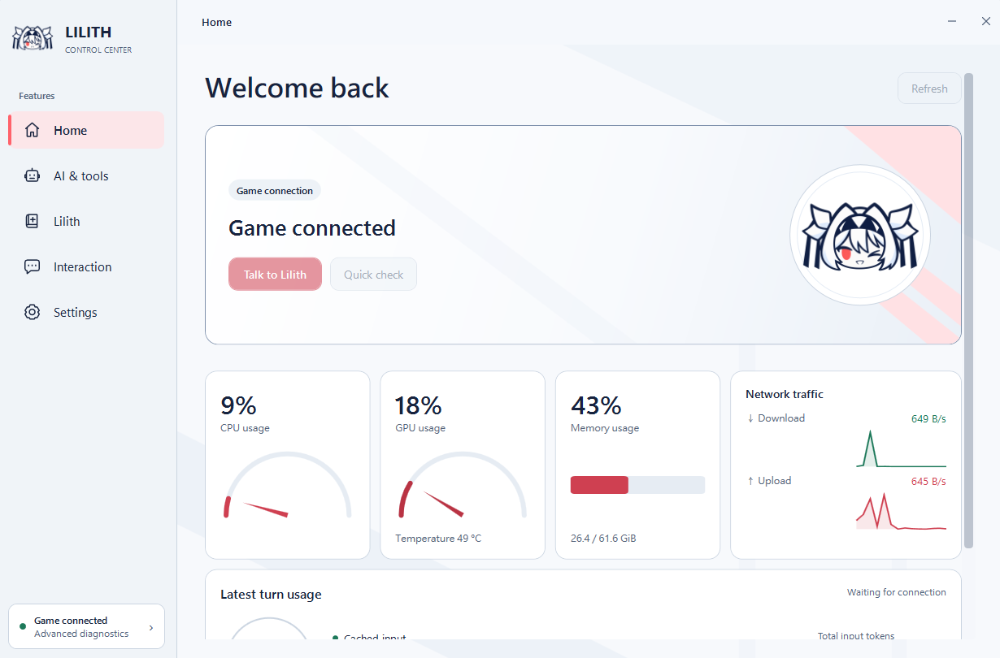
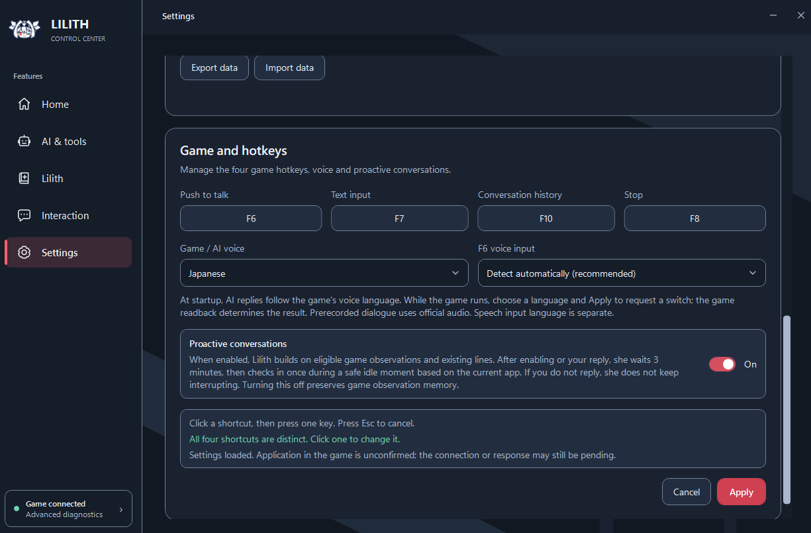

# Lilith AI MOD · 1.0.0 Beta.4

[繁體中文](README_繁體中文.md) · [简体中文](README_简体中文.md) · [English](README_EN.md) · [日本語](README_日本語.md)

リリスと会話し、一緒の思い出を重ね、ババ抜きやチェスでも遊べます。Beta.4では独立したコントロールセンターを導入し、記憶・モデル・ツールの仕組みを刷新しました。旧版のLOCAL起動方式は使用しません。

非公式・非商用のコミュニティ制作MODです。64ビット版WindowsとSteam版リリス本体が必要です。

## ダウンロードと導入

- [Googleドライブ：Beta.4](https://drive.google.com/drive/folders/1q8GcsuKSjPZCbKw8HYrMYR1dgThBhfUe?usp=sharing)
- [百度ネットディスク：Beta.4](https://pan.baidu.com/s/1xAt9y_MZ1DJMohHZ90bEQw?pwd=6666) — 抽出コード **6666**
- [インストール・更新ガイド](docs/INSTALLATION_JA.md) · [Discord](https://discord.gg/b3eJJhEfAC)

本体パッケージは約**4.99 GB**。任意の**AI音声依存パッケージ約3.70 GBは別ダウンロード**です。ミニゲームの画像・効果音・固定の中国語／日本語音声は本体に含まれます。AI会話の音声合成には互換性のある依存環境が必要です。

1. ゲームとコントロールセンターを終了し、本体ZIPを展開します。
2. `Setup.exe`と`Main.zip`を同じフォルダーに置きます。Main.zipは展開しません。
3. Setupを開き、`Lilith.exe`のあるゲームフォルダーを選び、必要に応じて音声を導入します。
4. **Lilith AI MODのデスクトップショートカット**からコントロールセンターを開き、モデル設定後にSteamからゲームを起動します。

**旧構成・以前のクローズドテスト版の記憶はBeta.4と互換性がありません。** 初めて移行する場合は[導入ガイド](docs/INSTALLATION_JA.md)に従って、リリス専用の旧プログラムと旧データを削除し、新規インストールしてください。旧会話・記憶・設定の保持、コピーによる復元、インポートは行わないでください。システムのLOCAL、AppData、BepInEx全体を削除してはいけません。

データを引き継げるのは、今後の新構成の更新で互換性が明記された場合だけです。「完全オフライン」は依存環境の取得方式です。クラウドモデルには通信と自分のアカウント／API設定が必要です。旧起動バッチは使用しません。

## 独立したコントロールセンター

会話、モデル、記憶、交流、ツールをまとめて管理できます。チャットの作成・切り替え、画像添付、生成画像のプレビューに対応。ホームにはゲーム接続、PC全体のリソース、直近のモデル使用量を表示します。ライト／ダーク／システム連動テーマ、通知領域への格納、任意のログイン時起動も用意しています。



- **記憶の管理：** 好み、習慣、大切な約束、期限付きの予定、共有体験を整理。推測は承認待ちとして確認でき、修正・固定・非表示・削除や自動記憶の無効化が可能です。
- **データ保存：** 新構成と互換性のある会話・記憶のエクスポート／インポート。旧構成の記憶には対応しません。インポートは上書きなので先にバックアップしてください。APIキーは含みません。
- **モデル選択：** Gemini、DeepSeek、OpenAI、Anthropic、OpenRouter、カスタム互換クラウド、Ollama、LM Studioなど。機能と料金はサービスごとに異なり、ローカルモデルのサービスは別途準備します。
- **6段階の情報整理：** 節約重視から豊富なコンテキストまで選択でき、必要時だけツール定義を読み込めます。元の会話は削除せず、固定の節約額は保証しません。
- **ツール：** 有効化・承認された範囲でウェブ検索、ブラウザー／Windows操作、ファイルやメディアサービスを利用できます。Telegram会話も設定可能です。

## 画面を話題に、声で会話

ローカル画面理解はPC上で画面や文字を解析し、会話の背景として渡します。個別に切り替えられ、常時監視ではありません。**クラウドの会話モデルを選んだ場合、抽出した文字情報はそのサービスへ送られます。ほかの画像ツールではクラウド認識を使う場合もあります。**

自発的な会話は、対象となる原作台詞に続けたり、適切な空き時間に今の状況を話題にしたりできます。返事がなければ繰り返し催促しません。自動の手紙には一日の上限があり、手動で手紙を頼む機能やメモもあります。中国語／日本語の声と日本語の感情表現を更新し、読み上げ言語と入力言語を別々に設定できます。



| 対象 | 対応言語 |
| --- | --- |
| コントロールセンター | 繁体字中国語、簡体字中国語、日本語、英語、ロシア語 |
| ミニゲーム字幕・メニュー | 繁体字／簡体字中国語、日本語、英語、韓国語、ロシア語、ラテンアメリカスペイン語、ブラジルポルトガル語、インドネシア語、タイ語、トルコ語、ベトナム語の12言語 |
| 音声 | 中国語・日本語。ミニゲーム182種類の台詞、計364本の固定録音 |

## 一緒に遊ぶ

**ババ抜き：** おやつ時間から開始。ドラッグで手札を並べ替えられ、リリスも自分の手札を整理します。カードを引く、ペアを見せる、カードを投げて散らす動きと効果音を追加しました。リリスは台詞や会話でブラフを言うこともあり、ジョーカーの場所を聞いても正直に答えるとは限りません。


**チェス：** ピンクと白の疑似3D盤面。クリックとドラッグの両方に対応し、合法手の点、選択／チェックの発光表示、プロモーションがあります。カジュアルは時間制限なし、チャレンジは持ち時間を調整可能。先手を交代し、勝敗に応じて難易度が変わります。リリスは少し考えてから指します。ダブルクリックで対局メニューを表示。着手はローカルStockfishが担当し、難易度は正式に測定されたEloではありません。


**対局中も会話：** 確定したドロー、ペア、着手、駒の取り合いはPC内に蓄積します。F6／F7で話すときやリリスが自発的に話すとき、その間の出来事と現在の局面を一緒に渡します。毎手ごとの会話モデル呼び出しは行わず、最近の会話を通じて状況を共有します。全対局を永久保存する棋譜機能ではありません。

## その他の改善と操作

- 初期キーは**F6**音声入力、**F7**文字入力、**F10**会話履歴、**F8**停止。設定で変更できます。
- 原作音楽プレイヤーにFLAC対応を追加。リリスが前面で文字入力中でなければ、**Ctrl+←／→**で曲送り、**Ctrl+Space**で一時停止／再開できます。
- LilithCursorGuardを統合し、背景のリリスが他ゲームのカーソル制限に干渉する問題に対応しています。

## 現在の構成

```text
コントロールセンター：会話・設定・記憶管理
                     ↓
ローカルサービス + Hermes ↔ 選択したクラウド／ローカルモデル
                     ↕
リリス本体：音声・交流・ミニゲーム
```

モデルは会話とツール操作の補助を担当し、ゲームのルール、実際の操作、音声再生はローカルのプログラムが処理します。設定に項目があることと、その外部サービスが利用可能なことは別です。対応範囲と負荷はモデル・設定・ハードウェアによって変わります。

## ソースと謝辞

[ビルド案内](BUILDING.md)。プレイヤーはGitHubのソースZIPではなく、上記の完成済み配布パッケージを使用してください。

[Hermes Agent](https://github.com/NousResearch/hermes-agent)、[SmallYuanSY／LilithCursorGuard](https://github.com/SmallYuanSY/LilithCursorGuard)（MIT）、[Kenney Casino Audio](https://kenney.nl/assets/casino-audio)（CC0）、[Stockfish](https://github.com/official-stockfish/Stockfish)（GPL-3.0）、[Gera.Chess](https://github.com/Geras1mleo/Chess)、[GPT-SoVITS](https://github.com/RVC-Boss/GPT-SoVITS)をはじめとする上流プロジェクトに感謝します。統合は公式の支持を意味しません。各ソフトウェア・モデル・素材にはそれぞれのライセンスが適用され、通知は配布パッケージに同梱されています。

不具合報告にはバージョン、再現手順、診断情報を添えてください。APIキー、私的な会話、記憶の保存ファイルは公開しないでください。[Discordへ](https://discord.gg/b3eJJhEfAC)。
