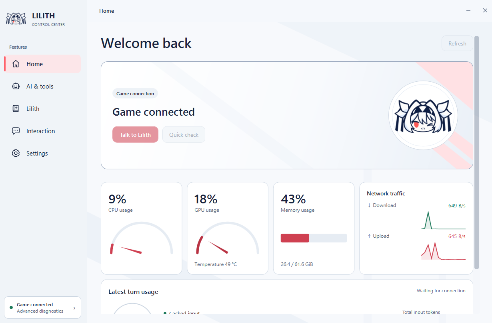
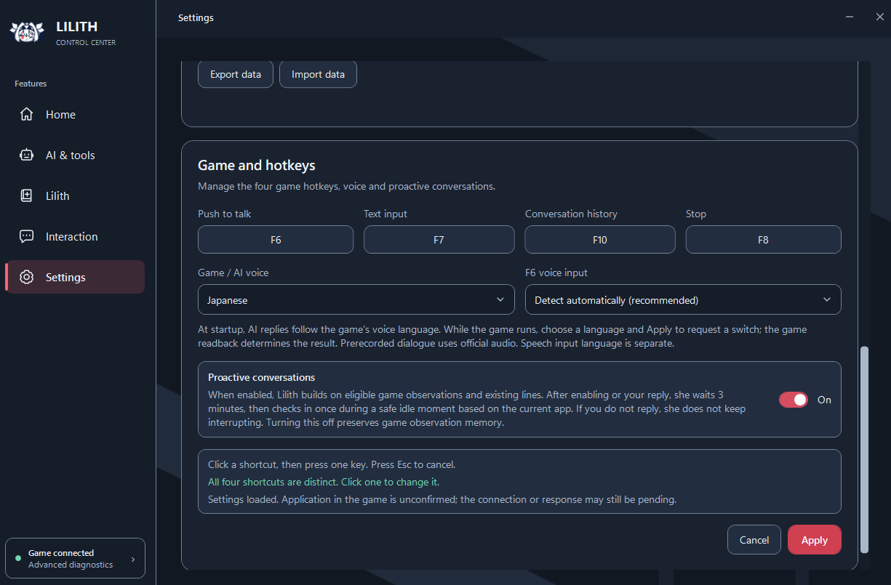

# Lilith AI MOD · 1.0.0 Beta.4

[繁體中文](README_繁體中文.md) · [简体中文](README_简体中文.md) · [English](README_EN.md) · [日本語](README_日本語.md)

让莉莉丝陪你聊天、记住相处中的小事，也能一起抽鬼牌、下国际象棋。Beta.4 已改用独立控制中心与新的记忆、模型和工具架构；旧版 LOCAL 启动方式不再适用。

这是非官方、非商业用途的社区 MOD，需要 Windows 64 位系统与 Steam 莉莉丝本体。

## 下载与安装

- [Google 云端：Beta.4](https://drive.google.com/drive/folders/1q8GcsuKSjPZCbKw8HYrMYR1dgThBhfUe?usp=sharing)
- [百度网盘：Beta.4](https://pan.baidu.com/s/1xAt9y_MZ1DJMohHZ90bEQw?pwd=6666)，提取码 **6666**
- [完整安装／更新教程（繁体中文）](docs/INSTALLATION.md) · [Discord 社区](https://discord.gg/b3eJJhEfAC)

主包约 **4.99 GB**；可选 AI 语音依赖包约 **3.70 GB**，需要另行下载。主包已有小游戏图片、音效与固定中日录音；实时 AI 合成语音另需兼容依赖。

1. 关闭游戏与控制中心，解压主包。
2. 将 `Setup.exe` 与 `Main.zip` 放在同一文件夹；不用解压 Main.zip。
3. 运行安装器，选择包含 `Lilith.exe` 的游戏位置，按需安装语音。
4. 从 **Lilith AI MOD 桌面快捷方式**打开控制中心，设置模型，再从 Steam 启动游戏。

**旧架构／此前封闭测试版的记忆与 Beta.4 不兼容。** 首次迁移须按[安装教程](docs/INSTALLATION.md)清除莉莉丝专用的旧程序与旧数据，再全新安装；不要保留、搬入或导入旧聊天／记忆／设置。不要自行删除整个系统 LOCAL、AppData 或 BepInEx。

只有日后明确声明兼容的新版架构更新，才可沿用数据。“完全离线”指安装依赖来源；云端模型仍需要网络和自己的账号／API 设置。不要再使用旧启动批处理。

## 独立控制中心

聊天、模型、记忆、互动与工具集中管理；支持独立聊天室、图片附件与生成图片预览。首页显示游戏连接、整机资源与最近一轮模型用量；提供明暗主题、跟随系统、系统托盘与可选登录启动。



- **记忆管理：** 喜好、习惯、重要约定、临时安排与共同经历分别整理。可修改、置顶、隐藏或删除；推测信息留待确认，自动记忆可关闭。
- **数据保存：** 导出／导入新版兼容的聊天与记忆；不支持旧架构记忆。导入会覆盖当前数据，请先自行备份；存档不包含 API 密钥。
- **模型选择：** Gemini、DeepSeek、OpenAI、Anthropic、OpenRouter 等服务，以及自定义兼容云端、Ollama、LM Studio 等本地服务。各模型能力与费用不同，本地服务需要自行准备。
- **六档信息策略：** 从节能到丰富上下文，配合工具按需加载；不删除原始聊天，也不是固定费用保证。
- **工具协助：** 按已启用工具与授权，搜索网页、操作浏览器／Windows、处理文件和使用媒体服务；也能设置 Telegram 聊天。

## 陪伴、画面与语音

本地画面理解先在电脑分析画面与文字，再提供聊天线索。功能可独立开关，并非持续监控。**如果聊天模型在云端，整理后的文字仍会发送给该服务；其他图片工具也可能使用云端识别。**

主动对话能够延续原有台词，或在合适的空闲时刻关心当前情境；没有回复时不会一直催促。另有自动留信、每日上限、手动请她写信与备忘录功能。中日声线及日文情绪表现已更新，朗读与输入语言可以分别设置。



| 语言范围 | 支持内容 |
| --- | --- |
| 控制中心 | 繁中、简中、日文、英文、俄文 |
| 小游戏字幕／菜单 | 繁中、简中、日、英、韩、俄、拉美西语、巴西葡语、印尼、泰、土耳其、越南，共12语 |
| 配音 | 中文、日文；小游戏182句对应台词，共364段固定录音 |

## 一起玩小游戏

**抽鬼牌：** 从点心时间进入，可拖动整理手牌，莉莉丝也会整理自己的牌。抽牌、配对亮牌、自然散落的抛牌动作与音效都已加入。她可以调皮地虚张声势，问鬼牌在哪，也未必得到老实答案。


**国际象棋：** 粉白伪3D棋盘，支持点击与拖动、合法位置灰点、选中／被将军的光晕及升变。休闲不计时，挑战可调时间；轮流先手，难度随胜负逐步调整，莉莉丝会稍作思考再走棋。双击她可打开对局选项。走棋由本地 Stockfish 处理，难度不是正式认证 Elo。


**边玩边聊：** 已完成的抽牌、配对、走棋与吃子先在本地累积；你用 F6／F7 开口，或她主动说话时，再附上这段经过和最新局面。她能跟上自己的手牌与棋局变化；不会每走一步就调用聊天模型，也不是永久完整棋谱。

## 其他更新与操作

- 默认 **F6** 语音、**F7** 文字、**F10** 对话记录、**F8** 停止，可在设置修改。
- 原有播放器加入 FLAC；莉莉丝在前台且非打字时，**Ctrl+←／→** 切歌，**Ctrl+Space** 暂停／继续。
- 集成 LilithCursorGuard，改善莉莉丝在后台时干扰其他游戏鼠标限制的问题。

## 当前架构

```text
控制中心：聊天、设置、记忆管理
              ↓
本地服务 + Hermes ↔ 选用的云端／本地模型
              ↕
莉莉丝游戏：语音、互动、小游戏
```

模型负责对话与工具协助；游戏规则、实际互动和语音播放由本地程序处理。功能表列出选项不代表所有服务都已连接；效果与资源需求随模型、设置和硬件而异。

## 源码与致谢

[构建说明](BUILDING.md)。发行包与源码用途不同；玩家安装请使用上方完整发行包。

感谢 [Hermes Agent](https://github.com/NousResearch/hermes-agent)、[SmallYuanSY／LilithCursorGuard](https://github.com/SmallYuanSY/LilithCursorGuard)（MIT）、[Kenney Casino Audio](https://kenney.nl/assets/casino-audio)（CC0）、[Stockfish](https://github.com/official-stockfish/Stockfish)（GPL-3.0）、[Gera.Chess](https://github.com/Geras1mleo/Chess)、[GPT-SoVITS](https://github.com/RVC-Boss/GPT-SoVITS)及其他上游项目。集成不代表上游官方背书；各组件、模型与素材按各自授权使用，完整声明随发行包提供。

反馈问题时，请附版本、复现步骤与控制中心诊断；不要公开 API 密钥、私人聊天或记忆存档。[加入 Discord](https://discord.gg/b3eJJhEfAC)。
